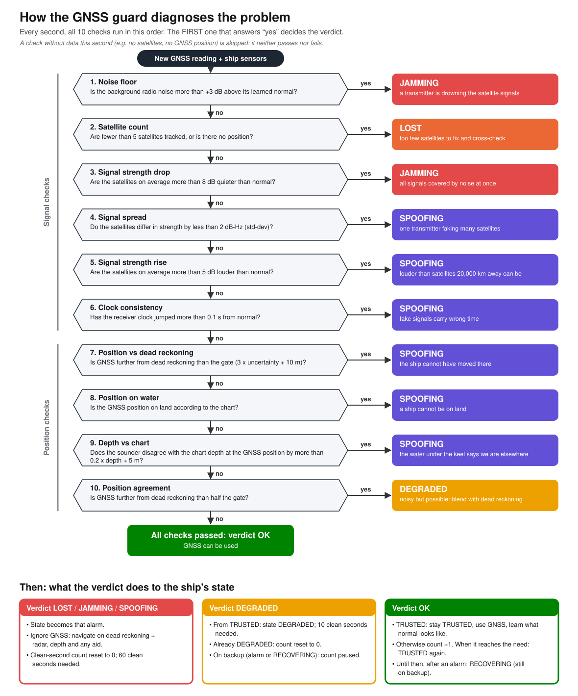

# MARINE – Baltic Sea GNSS trust monitor
Decides every second whether the satellite position can be trusted and keeps navigating on dead reckoning + radar/depth fixes when it cannot; set in the Gulf of Finland. Backend: `marine_guard/` (standard library only); simulator: `sim/`; texts: `teaching/`; full teaching website: `web/`; simple bridge view for navigators and pitches, with a choice of navigation aid (pseudolites or nearby ships, `sim/solutions.py`): `web-navigator/` (self-contained; both sites get their data from `python export_web.py`); optional Streamlit app: `app.py`.
Install: `pip install -r requirements.txt` (optional, needs internet: `python -m sim.bathymetry download` then `python export_web.py` for real EMODnet depths; otherwise the depth chart is SYNTHETIC and labelled so).
Test: `pytest`
Run the websites: open `web-navigator/index.html` (bridge view) or `web/index.html` (full teaching site) in a browser, or in VS Code use Run ▸ "Open bridge view" / "Open full teaching website" (or right-click either `index.html` ▸ "Open with Live Server"); after changing Python code run `python export_web.py`. Streamlit version: `streamlit run app.py`.

## Public website (deploy)
The public site is static: both websites plus a landing page, built into `dist/` by `python scripts/build_site.py` (standard library only; copies `site/`, `web-navigator/` → `/bridge/`, `web/` → `/learn/`; no Python source is published). All data is pre-computed by `python export_web.py` and committed, so the host only runs the copy step; the Streamlit app is not part of it. Preview exactly what will be published: `python scripts/build_site.py --serve` → http://localhost:8788 (applies `site/_headers`).
Host: Cloudflare Pages, build command `python3 scripts/build_site.py`, output directory `dist`, environment variable `SKIP_DEPENDENCY_INSTALL=1`; no secrets are needed (see `.env.example`). Everything shown is simulated: not for navigation.

## How a problem is diagnosed
Every second the 10 checks run in a fixed order and the first that fails decides the verdict, which then sets the ship's state ([`docs/diagnosis_flowchart.svg`](docs/diagnosis_flowchart.svg), PNG for slides alongside; regenerate with `python docs/flowchart.py`).

## The 5 correctional methods (choose under "Solution" in the bridge view)
When the guard stops trusting GNSS (LOST, JAMMING, SPOOFING, RECOVERING) it keeps navigating with dead reckoning: position += (speed through water × heading + learned sea current) every second, with an uncertainty that grows linearly. Each method corrects that estimate; every correction passes a plausibility gate (gap < 3 combined sigmas + 40 m) and is merged with a 1-D Kalman update, K = σ²/(σ² + σ_fix²). The **Accuracy** panel compares the resulting position with the simulated truth.
1. **None (guard only)** – built-in fixes (`marine_guard/backup.py`). *Radar*: every 10 s the range to the coast north of the ship gives the north coordinate (coast position from the chart). *Depth profile*: every 30 s the last 60 s of soundings are slid east-west over the chart in 5 m steps; the shift with the smallest mean squared depth difference corrects the east coordinate.
2. **Pseudolites** – hypothetical shore ranging stations on the Finnish and Estonian coasts (`marine_guard/aids.py: pseudolite_fix`). Each station gives a pseudorange (true range + receiver clock error); iterative weighted least squares solves east, north and clock (≥ 3 stations, HDOP ≤ 5). Noise grows as the signal weakens with distance or jamming; the stations are not spoofed.
3. **Nearby ships** – four ships tracked by radar (`peer_fix`). Our position = a ship's broadcast position − the radar range/bearing vector to it; each ship is one fix. Broadcasts are unencrypted: ships in the attack area broadcast jammed (drifting) or spoofed positions, so a slow spoof can lead the ship the wrong way.
4. **Seabed signature** – terrain matching (`seabed_fix`). Every 60 s the last 60 soundings, placed along the track from compass and log, are matched against the chart over a 2-D grid of offsets around the current estimate (coarse 50 m, then fine 10 m search, sum of squared depth differences). Accuracy comes from the match itself, per axis: all offsets that fit almost as well (χ², 99%) set the sigma, and an axis along which the seabed gives no information is ignored. Fails, honestly, over flat seabed.
5. **Auto (recommended, the default)** – a decision algorithm (`marine_guard/selector.py`) picks, every second, which of methods 2–4 to trust for the problem the guard has diagnosed, and the bridge view shows the solution in use and why. Every aid runs in the background; the selector passes the guard only the fixes of the trusted methods (each still has to pass the guard's plausibility gate).

### Decision algorithm (Auto)
| Problem (guard state) | Solution in use, in order of preference | Why |
|---|---|---|
| TRUSTED | GNSS | All 10 checks pass; aids on standby. |
| DEGRADED | GNSS blended with dead reckoning | GNSS is noisy but plausible (the guard ignores aids here). |
| LOST | Pseudolites, nearby ships, seabed | Often our own receiver has failed, so nearby ships' GNSS is probably fine. |
| JAMMING | Pseudolites, seabed | Nearby ships share the jammed area. Pseudolites are far stronger than satellites; the seabed is unaffected. |
| SPOOFING | Pseudolites, seabed | Nearby ships may broadcast the same fake positions (no encryption). Shore stations and the seabed cannot be faked this way. |
| RECOVERING | Same as the alarm that caused it | GNSS is not trusted until 60 clean seconds. |

Rules applied each second: (1) take the list for the current problem; (2) use every listed method that offers a fix now, the first being the main one (a method counts as in use for 120 s after its last fix); (3) if none is available, navigate on dead reckoning with the built-in radar and depth fixes; (4) if the guard rejects a method's fixes 30 times in a row, drop that method for 5 minutes, because it disagrees with everything else we know. Result on the 3-hour voyage: Auto matches or beats the best single method in every scenario (e.g. smart spoofing: 2 m average, 16 m worst, against 2.9 km with nearby ships alone).

